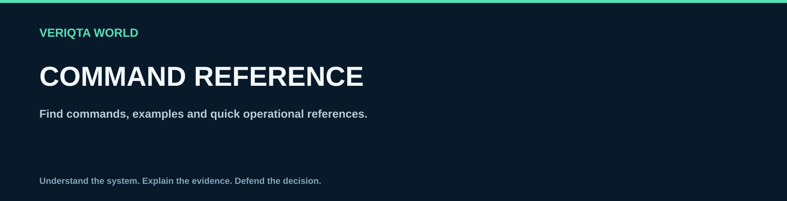

# Commands and cheat sheets

Find a command, understand its effects, practise it in isolation, and verify the result. This collection covers everyday Linux command use across ten administration domains. It is a curated reference rather than an exhaustive catalog of every Linux command or option.

## Choose your entry point

- **I know my task:** open the [command and task index](command-index.md).
- **I want a compact reminder:** open a category below for its at-a-glance table.
- **I am learning:** follow the category order, then complete each linked walkthrough.
- **I have an incident:** use the symptom guides in [folder 5](../05-troubleshooting-and-recovery/README.md) once those guides are populated. This collection explains tools; it does not establish a diagnosis.

| Category | What you will do | References |
| --- | --- | --- |
| [Files and directories](files-and-directories/README.md) | Navigate, copy, rename and locate files | 3 |
| [Text processing](text-processing/README.md) | Search lines, edit streams, summarize fields and compose pipelines | 4 |
| [Users and permissions](users-and-permissions/README.md) | Resolve identity, read modes and inspect sudo policy | 3 |
| [Processes and services](processes-and-services/README.md) | Observe processes, understand service state and read journals | 3 |
| [Networking](networking/README.md) | Read addresses/routes, inspect sockets, query DNS and use SSH | 4 |
| [Storage](storage/README.md) | Inspect capacity, mounts and LVM layers | 3 |
| [Packages](packages/README.md) | Review Debian-family APT and RPM-family DNF transactions | 2 |
| [Performance](performance/README.md) | Sample CPU, memory and I/O, then test hypotheses | 3 |
| [Security](security/README.md) | Review access and inspect firewall policy | 2 |
| [Backup and recovery](backup-and-recovery/README.md) | Archive, synchronize and verify a staged restore | 3 |

## Before you run a command

Use an unprivileged Bash shell in a disposable Linux VM. Keep snapshots and console access for administration practice. A VM booted with systemd is needed for service examples; a minimal container does not reproduce full host administration. See the existing [environment setup](../00-Start-Here/set-up-your-linux-environment.md) and [lab safety](../00-Start-Here/linux-lab-safety.md) material for context.

The intended baseline is GNU/Linux with Bash, GNU Coreutils and the named utility on each page. Package references distinguish Debian/Ubuntu APT from Fedora/RHEL-family DNF. This is a compatibility target, **not a claim that all examples have been tested on those distributions**. See the [validation record](VALIDATION.md).

1. Identify your environment with `cat /etc/os-release`, `uname -r` and `bash --version`.
2. Check availability with `command -v TOOL`, then inspect `TOOL --help` or `man TOOL`. Replace TOOL with a command such as `find`.
3. Read the permission and side-effect notes. `sudo` indicates elevated access; it is never a generic response to an unexplained error.
4. Inspect every path, identity, service and device before running a modifying command.
5. Run walkthroughs one command at a time in the same shell. Read results and capture exit status immediately after the command being investigated.
6. Follow the page’s verification and cleanup. When a check fails, stop and understand it before proceeding to removal or cutover.

Do not paste a whole page into a shell. Lookup tables contain abstract syntax and privileged changes; only the walkthrough has a defined sequence. Commands in a table are not instructions to execute all of them.

## Read command syntax

`command [OPTION]... ARGUMENT` means a program followed by optional flags and required operands. Square brackets and ellipses describe syntax; you do not type them. Uppercase names such as FILE, PATH, UNIT, USER and HOST are placeholders. Replace them with a verified value; do not type angle brackets around replacements.

In `cp -i -- "source file" "destination file"`, `-i` requests confirmation before replacement, `--` ends options, and quotes preserve spaces as part of a single argument. The shell interprets quotes, wildcards, variables and redirections before starting the program. `--` is common in GNU tools but is not universally accepted by all commands.

`/` is the filesystem root; `~` is your home; `.` is the current directory; `..` is its parent. Linux paths are case sensitive. `*` expands names in the shell unless quoted. For example, `find . -name '*.log'` passes a pattern to find rather than expanding names before find runs.

A command usually returns status 0 for success, but nonzero needs interpretation. `grep` returns 1 for no match; `diff` returns 1 for differences. Check `printf '%s\n' "$?"` immediately after a command. A successful command is not automatically evidence that the application or system is healthy.

## What each detailed reference contains

Every page has a purpose, environment and permissions, a compact syntax table, a follow-along sequence, expected results, limitations, cleanup guidance and upstream references. Exact PIDs, addresses, timestamps and versions will vary. Examples with temporary directories modify only the named disposable paths. Read-only walkthroughs explicitly state when no cleanup is needed.

Storage changes, firewall activation, production service restarts and account deletion require environment-specific plans. Their effects are explained in lookup notes; generic destructive recipes are deliberately excluded. Later labs can teach those operations with isolated devices and rehearsed recovery.

## How this fits the repository

Folder 4 answers “what does this command do, and how can I practise it?” Folder 5 will answer “what evidence distinguishes these possible failures?” Folder 6 will define repeatable administration with prechecks and rollback. Folder 7 will explain distribution differences. Folder 8 will hold broader documentation and terminology.

Read the [assessment and architecture](../docs/folders-04-08-assessment.md) for the measured starting state, scope boundaries and the quality gates for future installments.

[Validation and Linux review checklist](VALIDATION.md) · [Content standard](../CONTENT-STANDARD.md) · [LINUX-WORLD](../README.md)
