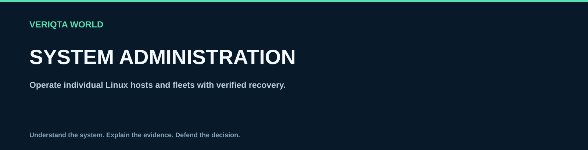

# Production administration

Learn to operate Linux services through planned, verifiable work. Production administration includes understanding the service owner and dependencies, assessing a proposed change, preserving a recovery path, performing the work and proving the intended user outcome. Running a privileged command is only one part of that responsibility.

## Choose a runbook

| Responsibility | Runbook | Follow-along practice |
| --- | --- | --- |
| Accept a server into service | [Server readiness](linux-server-readiness-checklist.md) | Build an evidence-backed readiness record |
| Grant, review and revoke access | [Access and sudo](user-access-and-sudo-management.md) | Draft and validate an isolated policy without installing it |
| Apply updates within a change window | [Patching and maintenance](patching-and-maintenance.md) | Prepare a plan and inspect a package-manager proposal |
| Change a service's running state | [Service management](service-management-and-restart-safety.md) | Restart a disposable systemd user service |
| Retain useful logs within storage limits | [Logs and rotation](log-management-and-rotation.md) | Rotate a private exercise log using a separate state file |
| Recover data within agreed objectives | [Backup and restore](backup-and-restore-operations.md) | Create, corrupt, detect and restore a static sample |
| Detect impact and route useful signals | [Monitoring and alerting](monitoring-and-alerting.md) | Evaluate failures and recoveries using a bounded sample sequence |
| Preserve resource headroom | [Capacity reviews](capacity-and-performance-reviews.md) | Calculate reserve-aware runway from a sample workload |
| Deploy and undo a configuration change | [Configuration and rollback](configuration-changes-and-rollback.md) | Reject an invalid candidate, promote a valid one and roll back |
| Retire a server without losing obligations | [Decommissioning](linux-server-decommissioning.md) | Evaluate retirement gates against a mock asset record |

## Read this before using the runbooks

These are learning resources and adaptable operating procedures, not permission to change a system you do not own. Use a disposable Linux VM with console recovery for privileged practice. Use Bash and Python 3.8 or newer for repository exercises. systemd examples need a working manager; package and log commands need the named tools. Distribution names describe families, not a claim of identical defaults.

Each runbook explains assumptions, a preflight, the operating sequence, a bounded lab, verification, rollback or stop conditions, cleanup and authoritative references. Read the entire lab before running commands. Uppercase tokens such as UNIT, PACKAGE and DIRECTORY are placeholders. Diagnostic snippets are selected checks, not a script to paste into an unknown host.

Run exercises that reference `labs/` from the repository root. Keep their shell variables until cleanup. Some steps intentionally fail to demonstrate a control: the text identifies expected nonzero statuses and explains what they establish.

## Use a common change record

Before a real change, record:

- Service/system identity, owner, operator and the authorization/change record.
- Purpose, exact scope, affected dependencies and expected user impact.
- Environment, current configuration/version and relevant baseline evidence.
- Start/end of the window, communication path and decision owner.
- Recovery prerequisites: console access, restorable data, compatible previous state and required secrets.
- The planned steps, verification criteria, stop/rollback trigger and maximum acceptable interruption.
- Afterward: actual changes, results, deviations, outstanding risks and follow-up owner.

Approval to perform a change is different from evidence that the change is safe. If a prerequisite is missing, record the gap and stop that change. For incidents, follow [folder 5](../05-troubleshooting-and-recovery/README.md) to distinguish facts from hypotheses before applying a recovery action.

## Verification has several layers

A valid configuration, an active unit, a successful backup job and a healthy service are different claims. Check the affected user operation, data correctness, dependencies, latency/errors, queues and resource headroom as appropriate. Define the observation window from the workload and previous failure mode. Keep temporary mitigations visible rather than silently treating them as permanent design.

The exercises are deliberately smaller than real operations. File-based simulations do not reproduce a live database, a package maintainer script, distributed failover or infrastructure deletion. See [validation and reproduction requirements](VALIDATION.md) for what was actually tested and what remains pending.

[Command explanations](../04-commands-and-cheat-sheets/README.md) · [Command tables](../09-cheat-sheets) · [Troubleshooting](../05-troubleshooting-and-recovery/README.md) · [LINUX-WORLD](../README.md)
